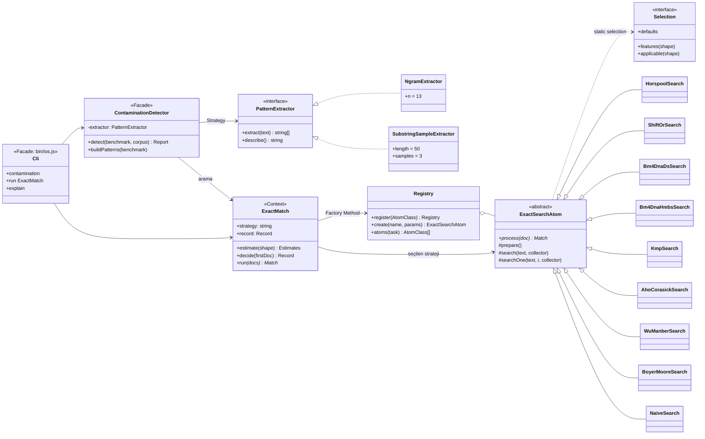

# Tasarım: desenler, SOLID ve sınıf diyagramı

Bu belge sunumda "hangi deseni nerede, neden kullandınız?" sorusuna cevaptır.
Diyagramın görüntüsü: `docs/figures/sinif_diyagrami.png` (`docs/figures/make_figures.py` çizer; metin hâli: `docs/figures/sinif_diyagrami.mmd`).

Proje iki katmandır:

1. **Arama çekirdeği (IoS atom/molekül modeli):** aynı işi yapan 9 tam eşleştirme algoritması (atom) ve girdiye bakıp
   en hızlısını seçen `ExactMatch` molekülü. Alana bağlı değildir; her metinde çalışır.
2. **Yapay zekâ uygulaması (kirlenme tespiti):** `ContaminationDetector`, bir LLM benchmark'ının test sorularının eğitim
   verisinde birebir geçip geçmediğini bu çekirdekle bulur.

## Tasarım desenleri

| Desen (GoF) | Nerede | Neden |
| --- | --- | --- |
| **Strategy** (1) | Her atom (`HorspoolSearch`, `WuManberSearch`, …) bir *ConcreteStrategy*; `ExactMatch` *Context*; ortak arayüz `ExactSearchAtom` (`process`) + `selection`. | Aynı işi yapan, birbirinin yerine geçebilen algoritmalar. Molekül çalışma anında birini seçer ya da kullanıcı `strategy` ile zorlar. Büyük `if/else` bloğu yok. Hocanın slaytındaki "Navigasyon → Otobüs/Taksi/Bisiklet" örneğinin aynısı. |
| **Strategy** (2) | Desen çıkarıcılar: `NgramExtractor` (GPT-3 yöntemi) ve `SubstringSampleExtractor` (GPT-4 yöntemi); ortak arayüz `extract(metin)` + `describe()`; *Context* `ContaminationDetector`. | Kirlenme literatüründe iki farklı yöntem var. Dedektör hangisinin kullanıldığını bilmez; yapıcıya verilen çıkarıcıyı çağırır. |
| **Template Method** | `ExactSearchAtom.process()`: koda çevirme → `search()` → sıralı çıktı. Alt sınıf yalnızca `prepare()` ve `search()`/`searchOne()` yazar. | Sözleşme kuralları (sıralama, ignoreCase, parametre denetimi) tek yerde kalır; her atom aynı kuralları otomatik uygular. |
| **Factory Method** | `Registry.create(name, params)` atomları, `createExtractor(method, options)` çıkarıcıları adıyla üretir. | Molekül `new HorspoolSearch(...)`, komut satırı `new NgramExtractor(...)` yazmaz; adı bilmesi yeter. |
| **Registry** | `src/registry.js`: `register`, `get`, `atoms(task)`, `clone`. | Yeni atom = tek satır. Test içinde sahte atom `clone().register(...)` ile eklenir, varsayılan defter kirlenmez. |
| **Facade** | `ContaminationDetector.detect()`: normalleştirme, desen çıkarma, korpusu birleştirme, `ExactMatch` ile arama ve soru bazında özet tek çağrıda. `bin/ios.js`: JSONL okuma, molekül/dedektör kurma, çıktı yazma tek komutta. | Kullanıcı iç yapıyı bilmeden `contamination`, `run`, `explain` ile çalışır. |

## SOLID

| İlke | Nasıl sağlandı | Kanıt |
| --- | --- | --- |
| **S** Tek sorumluluk | `functions/` yalnızca algoritma çekirdeği, `atomic/` sözleşme ve seçim bilgisi, `molecules/` karar, `shape.js` veri şekli, `corpus.js` JSONL okuma, `contamination/normalize.js` yalnızca normalleştirme, `extractors.js` yalnızca desen çıkarma, `ContaminationDetector` yalnızca adımları birleştirme, `bin/` giriş/çıkış. | Dosya yapısı |
| **O** Açık/kapalı | Yeni atom eklemek molekülü, yeni bir kirlenme yöntemi eklemek dedektörü değiştirmez. | `molecule.test.js`: "sahte atom … molekül kodu değişmeden seçilebilir" |
| **L** Liskov | Her atom diğerinin yerine kullanılabilir: hepsi aynı sözleşme testlerinden geçer, dedektör hangi atomla çalışırsa çalışsın aynı kirli soruları bulur. | `contract.test.js`, `random.test.js`, `contamination.test.js` ("zorla seçilen her atom aynı sonucu verir") |
| **I** Arayüz ayrımı | Atomdan istenen yalnızca `manifest`, `selection` ve `process`; çıkarıcıdan yalnızca `extract` ve `describe`. Çok desenli atom `search`'ü, tek desenli `searchOne`'ı yazar. | `ExactSearchAtom.js`, `extractors.js` |
| **D** Bağımlılığın ters çevrilmesi | `ExactMatch` somut atomlara değil kayıt defterine ve `selection` arayüzüne; `ContaminationDetector` somut algoritmaya değil `ExactMatch`'e ve çıkarıcı arayüzüne bağlı. İkisi de yapıcıdan verilebilir. | `new ExactMatch({ patterns, registry })`, `new ContaminationDetector({ extractor, strategy })` |

## Sınıf diyagramı (metin hâli)



## Kâğıda çizilecek sade hâli

```
          «Facade» bin/ios.js  (contamination, run, explain)
                │                         │
                ▼                         │
   «Facade» ContaminationDetector         │
     detect(benchmark, corpus)            │
       │                  │               │
       ▼                  ▼               ▼
 «Strategy» PatternExtractor     ExactMatch (Context) ──► Registry (Factory)
   NgramExtractor (GPT-3)          decide(), run()          register, create
   SubstringSampleExtractor (GPT-4)        │ seçilen atom
                                           ▼
                         «abstract» ExactSearchAtom (Template Method)
                           process(doc) ← iskelet; prepare(), search() ← alt sınıflar
                                           ▲ kalıtım
     Horspool  ShiftOr  bm4DNADS  bm4DNAHMbs  KMP  Aho-Corasick  Wu-Manber  Boyer-Moore
```
