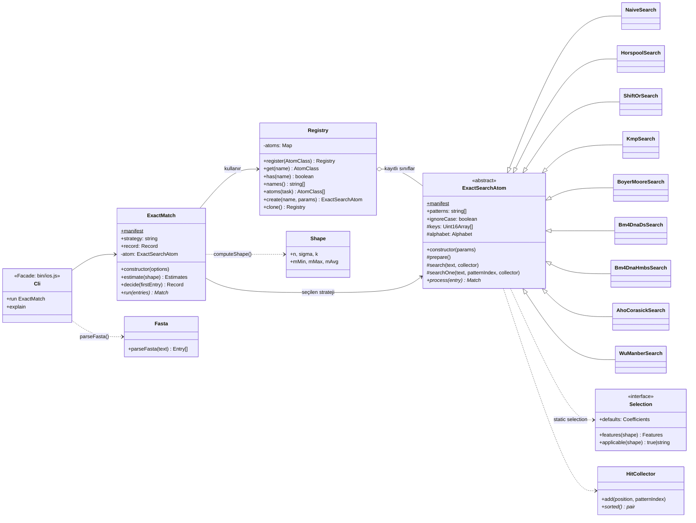

# Tasarım: desenler, SOLID ve sınıf diyagramı

Bu belge sunumda "hangi deseni nerede, neden kullandınız?" sorusuna cevaptır.
Diyagramın görüntüsü: `docs/figures/sinif_diyagrami.png` (kaynak: `docs/figures/sinif_diyagrami.mmd`).

## Tasarım desenleri

| Desen (GoF) | Nerede | Neden |
| --- | --- | --- |
| **Strategy** | Her atom (`HorspoolSearch`, `WuManberSearch`, …) bir *ConcreteStrategy*; `ExactMatch` *Context*; ortak arayüz `ExactSearchAtom` (`process`) + `selection`. | Aynı işi (tam eşleştirme) yapan birbirinin yerine geçebilen algoritmalar. Molekül çalışma anında birini seçer ya da kullanıcı `strategy` ile zorlar. Büyük `if/else` bloğu yok. Hocanın slaytındaki "Navigasyon → Otobüs/Taksi/Bisiklet" örneğinin aynısı. |
| **Template Method** | `ExactSearchAtom.process()`: kod çevirme → `search()` → sıralı çıktı. Alt sınıf yalnızca `prepare()` ve `search()`/`searchOne()` yazar. | Sözleşme kuralları (sıralama, ignoreCase, parametre denetimi) tek yerde kalır; her atom aynı kuralları otomatik uygular. Bir atom sıralamayı unutamaz. |
| **Factory Method** | `Registry.create(name, params)`; molekül atomu adıyla ürettirir. | Molekül somut sınıfları `new HorspoolSearch(...)` diye bilmez; adı bilmesi yeter. |
| **Registry** | `src/registry.js`: `register`, `get`, `atoms(task)`, `clone`. | Yeni atom = tek satır. Test içinde sahte atom `clone().register(...)` ile eklenir, varsayılan defter kirlenmez. |
| **Facade** | `bin/ios.js`: FASTA okuma, molekül kurma, karar, JSONL yazma tek komutun arkasında. | Kullanıcı iç yapıyı bilmeden `run` / `explain` ile çalışır. |

## SOLID

| İlke | Nasıl sağlandı | Kanıt |
| --- | --- | --- |
| **S** Tek sorumluluk | `functions/` yalnızca algoritma çekirdeği (saf hesap), `atomic/` yalnızca sözleşme ve seçim bilgisi, `molecules/` yalnızca karar, `shape.js` yalnızca veri şekli, `bin/` yalnızca giriş/çıkış. | Dosya yapısı |
| **O** Açık/kapalı | Yeni atom eklemek molekülün kodunu değiştirmez. | `molecule.test.js`: "sahte atom … molekül kodu değişmeden seçilebilir" |
| **L** Liskov | Her atom diğerinin yerine kullanılabilir: hepsi aynı sözleşme testlerinden geçer ve aynı sonucu verir. | `contract.test.js`, `random.test.js` ("zorla seçilen her strateji aynı sonucu verir") |
| **I** Arayüz ayrımı | Atomdan istenen yalnızca `manifest`, `selection` (`features`, `defaults`, `applicable`) ve `process`. Çok desenli atom `search`'ü, tek desenli `searchOne`'ı yazar; ikisini birden yazmak zorunda değil. | `ExactSearchAtom.js` |
| **D** Bağımlılığın ters çevrilmesi | `ExactMatch` somut atomlara değil, kayıt defterine ve `selection` arayüzüne bağlı; kayıt defteri yapıcıya parametre olarak da verilebilir. | `new ExactMatch({ patterns, registry })` |

## Sınıf diyagramı (tam)



## Kâğıda çizilecek sade hâli

Sınav/sunumda elle çizmek için yalnızca kutular ve ana metotlar:

```
                 «Facade» bin/ios.js  (run, explain)
                          │
                          ▼
   ┌───────────────── ExactMatch (Context) ──────────────────┐
   │ strategy, record                                         │
   │ decide(firstEntry), estimate(shape), run(entries)        │
   └──────────┬───────────────────────────────┬───────────────┘
              │ kullanır                      │ seçilen atom
              ▼                               ▼
   Registry (Factory)              «abstract» ExactSearchAtom (Template Method)
   register, get, create           process(entry)  ← iskelet, sabit
                                    prepare(), search()  ← alt sınıflar doldurur
                                              ▲ kalıtım
          ┌──────────┬──────────┬─────────────┼─────────────┬──────────┬───────────┐
       Horspool   ShiftOr     KMP     Bm4DnaDs / Bm4DnaHmbs   BoyerMoore  AhoCorasick  WuManber
                         (hepsi: static manifest + static selection)
```
